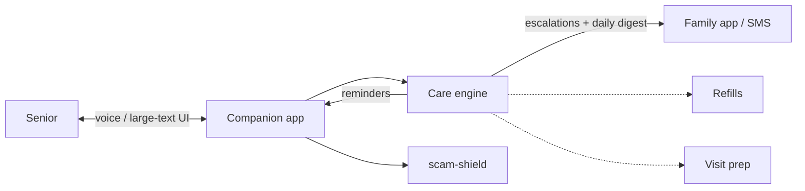

# Architecture — elder-companion

## 1. Scope
The care engine behind an AI companion for older adults: routines, adherence, check-ins,
escalations to family, and plain-language output.
**MVP:** medication schedules and reminders, dose status (taken, skipped, pending, missed after a
2 h grace period), adherence, daily check-ins, escalation rules, family digest, plain-language
rewriter with Flesch reading-ease scoring.
**Product:** voice-first companion app, family app, pharmacy and clinician integrations, scam screening.

## 2. System context

Note: the Companion app, Family app / SMS delivery, Pharmacy, Clinician, and scam-shield
links are roadmap, not shipped — this release is the care engine (schedules, check-ins,
escalations, digest, rewriter) behind a CLI and web API.

## 3. Escalation rules
- two consecutive missed or skipped doses of the same medication (across yesterday and today)
- no check-in by the deadline (default 11:00)
- pain ≥ 7, or red-flag words in the note ("fell", "dizzy", "chest pain", "can't breathe", …)
- mood ≤ 2 three days running

## 4. Design decisions
- **Grace period before "missed"** (2 h). Reminders aren't punitive, and family alerts should be rare and meaningful.
- **Rules, not ML, for escalations.** They're auditable, predictable and explainable to families.
  The red-flag lexicon is deliberately sensitive, because a false negative costs more than a false positive here.
- **Plain language as a system-wide output filter.** Everything spoken to the user passes through
  `simplify` (jargon map, sentence splitting) and is checked with reading ease.
- **The digest is written for adult children,** not clinicians: one short message a day, plus
  "needs attention" only when there's a reason.

## 5. Future production architecture (not shipped)
A mobile/tablet app (offline reminders via local notifications), a care-engine service
(Postgres: schedules, events, check-ins), a scheduler for deadline checks (per-user timezone), and
notification routing (push, SMS fallback). Data is HIPAA-grade: encryption, audit logs and
caregiver consent records. None of this is in this release: the shipped product is the
care engine plus CLI and web API described above.

## 6. Risks
This is not a medical device. Wording avoids clinical claims, and emergencies route to calling
emergency services. Privacy and autonomy: the senior controls what family members can see.
